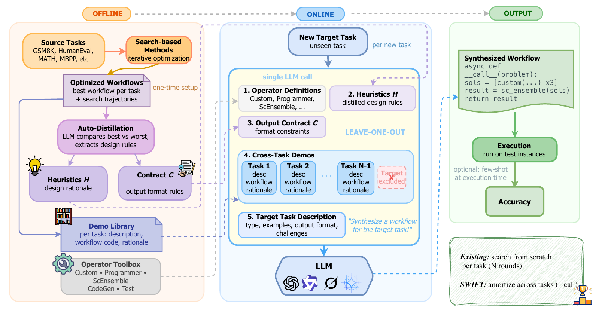

<div align="center">

# SWIFT
### Synthesizing Workflows via Few-shot Transfer

**Can Workflow Search Be Amortized?**<br>
**Demonstration-Guided Synthesis of LLM Agent Workflows**

Shiyi Du · Jiayuan Liu · Weihua Du · Yue Huang · Jiayi Li · Yingtao Luo · Xiangliang Zhang · Vincent Conitzer · Carl Kingsford

Carnegie Mellon University · Foundations of Cooperative AI Lab (FOCAL) · University of Notre Dame

[Overview](#overview) · [How it works](#how-it-works) · [Results](#results) · [Code release](#code-release) · [Citation](#citation)

**Reuse prior workflow search. Synthesize a workflow for a new task in one generation pass.**

</div>

> **Project status:** This repository currently contains the paper overview. Implementation, reusable workflow assets, and runnable examples are not yet available here.

## Overview

Designing an LLM agent workflow often means searching over many combinations of reasoning, verification, ensembling, and code execution for every new task. **SWIFT reuses what previous searches have already discovered.**

Given source-task search trajectories and workflow demonstrations, SWIFT distills reusable design heuristics and output-interface contracts. A single LLM generation call then combines these priors with a new task description to synthesize an executable workflow, without iterative target-task optimization.

<p align="center">
  
</p>

*Method overview from Figure 2 of the camera-ready paper.*

### Highlights

- **Single-pass workflow synthesis:** generate one candidate workflow without searching over and evaluating multiple candidates on the target task.
- **Reusable structural knowledge:** transfer complete workflow demonstrations, compositional heuristics, and output contracts from source tasks.
- **Strong benchmark results:** 85.34% average accuracy across five main benchmarks with GPT-4o-mini, compared with 82.25% for AFlow and 83.59% for MaAS.
- **Low marginal optimization cost:** the MATH case study reports $0.004 for distillation over available source trajectories and target-workflow synthesis, compared with $22.50 for AFlow optimization.
- **Transfer beyond the source pool:** improvements on four additional held-out benchmarks, plus execution-backbone evaluations with Grok, Qwen, and Gemma.

**One synthesis call is not one execution call.** The generated workflow can invoke multiple operators and LLM calls when solving an input. The optimization-cost comparison assumes an existing source bank; constructing that bank has a separate upstream cost.

## How it works

### 1. Distill reusable priors offline

Compare successful and unsuccessful source-task workflows and their execution or parsing failures to extract:

- **Compositional heuristics:** design rules for choosing and connecting operators.
- **Output contracts:** intermediate and final output-format constraints that help operators exchange compatible results.
- **Workflow demonstrations:** source-task descriptions, executable workflow code, and design rationales.

### 2. Synthesize a workflow for a new task

Build a meta-prompt containing the operator library, distilled heuristics, output contracts, source demonstrations, and the target-task description. The generator produces one executable candidate workflow in a single pass.

### 3. Execute the synthesized workflow

Run the generated program on task inputs using the execution model. Workflow synthesis and workflow execution are separate stages: the synthesized structure can coordinate reasoning, verification, ensembling, or execution-feedback repair.

**Evaluation protocol.** Source-pool tasks use task-level leave-one-out: the target task's examples, search trajectories, error logs, and optimized workflows are excluded from the synthesis inputs. Held-out benchmarks are absent from both trajectory distillation and demonstration construction.

## Results

Results below are reported in the camera-ready paper; they have not yet been reproduced from this repository.

### Main benchmarks

Test accuracy (%) with GPT-4o-mini. Selected comparisons from **Table 1**; the paper includes the full baseline set.

| Method | GSM8K | MATH | HumanEval | MBPP | MultiArith¹ | Average |
| :--- | ---: | ---: | ---: | ---: | ---: | ---: |
| Vanilla | 87.45 | 46.29 | 87.08 | 71.83 | 96.85 | 77.90 |
| AFlow | 91.16 | 51.28 | 90.93 | 81.67 | 96.22 | 82.25 |
| MaAS | 92.30 | 51.82 | 92.85 | 82.17 | **98.80** | 83.59 |
| **SWIFT** | **94.31** | **55.14** | **95.42** | **83.28** | 98.54 | **85.34** |

¹ MultiArith is not part of the source demonstration pool. SWIFT improves over AFlow on all five main benchmarks and has the highest average accuracy among the methods compared in the paper.

### Transfer to additional held-out benchmarks

Accuracy (%) from **Table 2**. None of these benchmarks is included in the source demonstration pool.

| Benchmark | Vanilla | SWIFT | Gain (percentage points) |
| :--- | ---: | ---: | ---: |
| SVAMP | 81.0 | 95.8 | +14.8 |
| AIME 2024–2025 | 8.3 | 14.6 | +6.3 |
| AQuA | 52.9 | 79.9 | +27.0 |
| BigCodeBench | 31.6 | 34.3 | +2.7 |

### Optimization efficiency

MATH with GPT-4o-mini, from **Table 3**. These columns describe workflow optimization, excluding execution on the test set.

| Method | Optimization cost (USD) | Optimization time | Accuracy (%) |
| :--- | ---: | ---: | ---: |
| AFlow | $22.50 | 184 min | 51.28 |
| MaAS | $3.38 | 53 min | 51.82 |
| **SWIFT** | **$0.004** | **0.13 min** | **55.14** |

SWIFT's reported optimization cost includes contrastive distillation over available source trajectories and single-pass synthesis. It excludes the search needed to create those source trajectories. Under the paper's cold-start accounting, the upstream source bank costs approximately **$112.50**, with a break-even point of about **five downstream tasks** relative to per-task search (Section 4.2 and Appendix G). These are experimental measurements, not current API price estimates or guarantees for arbitrary tasks.

### Execution-model portability

Holding the synthesized workflows and operator instructions fixed, the paper evaluates Grok-4.1-fast, Qwen3-8B, and Gemma-3-12B-IT across six benchmarks. SWIFT improves accuracy on **16 of 18** benchmark–model pairs (**Table 5**). Gains vary by model and task; for example, Gemma's MATH accuracy decreases, illustrating that transferred workflows depend on the executor's instruction-following ability.

## Scope and limitations

SWIFT is most relevant when source workflows or search traces already exist, or when their construction cost can be shared across multiple related tasks. The paper primarily evaluates static reasoning and code-generation benchmarks with automatic correctness signals.

Transfer is sensitive to task-family alignment, output-interface compatibility, execution dependencies, and the capabilities of the execution model. The reported results do not establish effectiveness in general stochastic, interactive, or irreversible environments.

## Code release

The implementation is being prepared for this repository. Installation instructions and API examples will be added alongside verified, runnable code.

The intended release will cover:

- Workflow synthesis and execution code.
- Source workflow demonstrations, distilled heuristics, and output contracts.
- A minimal end-to-end example and guidance for adapting a custom task.
- Evaluation configurations and paper-reproduction instructions.

## Citation

If you use SWIFT in your research, please cite the paper. The entry below uses the camera-ready title and author list; publication identifiers will be added when available.

```bibtex
@misc{du2026swift,
  title = {Can Workflow Search Be Amortized? Demonstration-Guided Synthesis of {LLM} Agent Workflows},
  author = {Du, Shiyi and Liu, Jiayuan and Du, Weihua and Huang, Yue and Li, Jiayi and Luo, Yingtao and Zhang, Xiangliang and Conitzer, Vincent and Kingsford, Carl},
  year = {2026}
}
```
